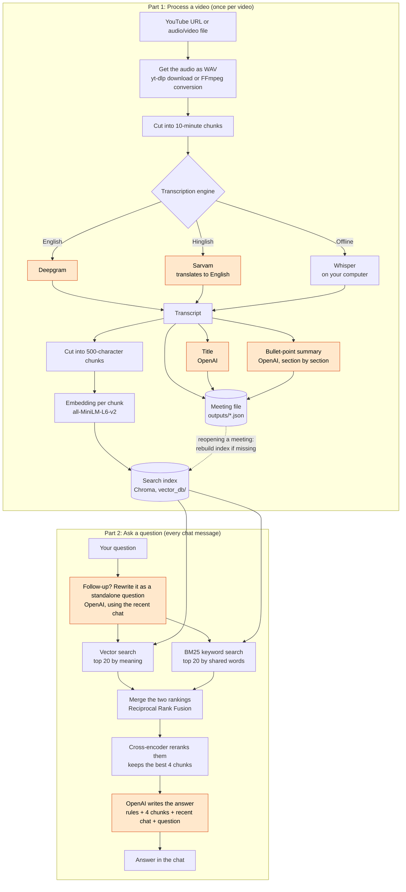

# AI Video Assistant

Turn a YouTube video or an audio/video file into a **transcript**, a **title and summary**, and a **chat** where you ask questions about what was said.

- **Transcribe** English with Deepgram, Hindi-English (Hinglish) with Sarvam, or offline with Whisper.
- **Summarize** the recording into bullet points with OpenAI.
- **Chat** with the video. Answers are based on the most relevant parts of the transcript, found with hybrid search and reranking. Follow-up questions such as "who created it?" understand the recent chat.
- **Measured**: retrieval and answer quality are evaluated with a retrieval benchmark and RAGAS. See [Evaluation](#evaluation).
- **Keep** your meetings: reopen them later, download the transcript, or delete them with all their data.
- Use it as a **web app** (Streamlit) or from the **terminal**.

## How it works

The pipeline has two parts. Part 1 runs once per video; part 2 runs for every question you ask.



Orange steps send data to a cloud service. Everything else runs on your computer.

### Part 1: Processing a video

1. **Get the audio.** `yt-dlp` downloads a YouTube video's audio as a WAV file. An uploaded file is converted to WAV (16 kHz, mono) with FFmpeg.
2. **Cut it into chunks.** The audio is cut into 10-minute pieces, so long recordings are sent piece by piece.
3. **Transcribe.** Each piece goes to the engine you picked, and the texts are joined into one transcript.
   - **Deepgram** (English, the default) runs in the cloud and is fast.
   - **Sarvam** (Hinglish) runs in the cloud. It accepts at most 30 seconds per request, so each piece is sent in 25-second slices, and it returns English text.
   - **Whisper** (English) runs on your computer. It is free and works offline, but it is slow.
4. **Write a title and summary.** OpenAI writes a title of up to 8 words from the first 2,000 characters. For the summary, the transcript is cut into 3,000-character sections. Each section is summarized, then the section summaries are merged into one bullet-point summary.
5. **Build the search index.** The transcript is cut into 500-character chunks that overlap by 50 characters. A local model (`all-MiniLM-L6-v2`) turns each chunk into an embedding, and the embeddings are stored in a Chroma collection that belongs to this meeting only.
6. **Save the meeting.** The title, transcript, summary, index name and list of audio files go into `outputs/<meeting>.json`.

### Part 2: Answering a question

1. **Rewrite follow-ups.** From the second question on, OpenAI rewrites your question with the recent chat so it stands on its own: after "What is MCP?", the question "Who created it?" is searched as "Who created the Model Context Protocol (MCP)?". The first question is searched as you typed it.
2. **Find candidates in two ways.**
   - Vector search returns the 20 chunks closest in meaning to the question, even when the wording differs.
   - BM25 keyword search returns the 20 chunks that share the most words with it. It ignores filler words such as "what" or "say", so exact names, numbers and jargon aren't missed.
3. **Merge the two lists.** Reciprocal Rank Fusion combines both rankings into one list of 20 to 40 candidates. Chunks that rank high in both searches come first.
4. **Rerank.** A cross-encoder reads the question together with each candidate and scores how well the candidate answers it. The best **4** chunks (about 2,000 characters) are kept.
5. **Answer.** OpenAI receives a set of rules, the 4 chunks, the last 3 questions and answers, and your question, and writes the answer.

The rules tell the model to:

- Answer questions about the video from the 4 chunks, and say so when they don't contain the answer.
- Read "he", "she" or "the speaker" as the person talking in the transcript.
- Reply briefly to greetings such as "hi" or "thanks".
- Answer unrelated questions from general knowledge, and say that the answer is not from the video.

Keep in mind:

- The chat remembers the last 3 questions and answers. Older messages are not sent, and a follow-up costs one extra small OpenAI call for the rewrite.
- The model sees only 4 chunks. Questions about the whole video, such as "list every topic", can get incomplete answers. Use the Summary tab for an overview.

### Terms used above

| Term | Meaning |
|---|---|
| Chunk | A short piece of the transcript, about 500 characters here. |
| Embedding | A list of numbers that represents the meaning of a text. Texts with similar meanings get similar numbers. |
| Vector search | Finds the chunks whose embeddings are closest to the question's embedding: the same meaning, even in different words. |
| BM25 | A classic keyword-ranking formula. It favours chunks that contain the question's words, especially rare ones. |
| Reciprocal Rank Fusion (RRF) | Merges ranked lists by position instead of by score, because the two searches score on different scales. |
| Cross-encoder reranker | A small model that reads the question and a chunk together and scores their relevance. It is slower than search, so it checks only the candidates. |

## Quick start

### Requirements

- Python 3.10 or later.
- FFmpeg on your `PATH`:
  - Windows: `winget install Gyan.FFmpeg`
  - macOS: `brew install ffmpeg`
  - Ubuntu or Debian: `sudo apt install ffmpeg`
- API keys:
  - **OpenAI**: always needed (title, summary and chat).
  - **Deepgram**: needed for the English engine, which is the default.
  - **Sarvam**: needed only for Hinglish.

### Install

Windows (PowerShell):

```powershell
python -m venv .venv
.\.venv\Scripts\Activate.ps1
python -m pip install -r requirements.txt
Copy-Item .env.example .env
```

macOS or Linux:

```bash
python3 -m venv .venv
source .venv/bin/activate
python -m pip install -r requirements.txt
cp .env.example .env
```

The install is large because it includes PyTorch. On first use the app also downloads its local models: the embedding model and the reranker (about 90 MB each), plus the Whisper model if you use Whisper (`small` is about 460 MB).

Open `.env`, add your keys (see [Configuration](#configuration)), then check your setup:

```bash
python check_setup.py
```

It checks your keys, FFmpeg, yt-dlp and the project imports, and makes a tiny test call to Deepgram, Sarvam and OpenAI. If you don't use Hinglish, the Sarvam checks fail; you can ignore them.

### Run

Web app:

```bash
streamlit run app.py
```

Open the address it prints, usually http://localhost:8501. The app listens only on your own computer (set in `.streamlit/config.toml`), so other devices on your network can't open it.

Terminal:

```bash
python main.py
```

## Using the app

### Process a video

1. In the sidebar, choose **New video**.
2. Paste a YouTube URL, or upload a file (mp3, wav, m4a, mp4, mkv, webm or aac).
3. Pick an engine and click **Process video**. The steps are shown while it runs.

| Engine | Runs on | Best for | Needs |
|---|---|---|---|
| English — Deepgram | Cloud | English; fast (default) | `DEEPGRAM_API_KEY` |
| Hinglish — Sarvam | Cloud | Hindi-English speech, translated to English | `SARVAM_API_KEY` |
| English — Whisper (local) | Your computer | Free and offline; slow on a CPU | Nothing |

When processing finishes you see the title, the word count and reading time, a **Summary** tab, a **Transcript** tab with a .txt download, and the **chat**. A line under the chat heading confirms that reranking is on. If the reranker could not load, a warning appears there instead and answers use the merged search ranking.

### Saved meetings

Choose **Saved meetings** in the sidebar and pick a meeting:

- **Load meeting** reopens it. If its search index is missing, it is rebuilt from the saved transcript, which takes a few seconds.
- **Delete meeting** asks for confirmation, then removes the meeting file, its search index and its downloaded audio. This cannot be undone.

**Clear** only removes the meeting from the screen. It deletes nothing.

### Terminal app

`python main.py` lists your saved meetings. Type a number to reopen one, or paste a YouTube URL or file path to process a new video and choose `english`, `hinglish` or `whisper`. It prints the title and summary, then starts a chat; type `exit` to quit. Deleting meetings is available only in the web app.

## Configuration

All settings live in `.env`. The template is `.env.example`.

| Variable | Needed? | Default | What it does |
|---|---|---|---|
| `OPENAI_API_KEY` | Yes | | Title, summary and chat. |
| `OPENAI_MODEL` | No | `gpt-4o-mini` | The OpenAI model to use. |
| `DEEPGRAM_API_KEY` | For the English engine | | Deepgram transcription. |
| `DEEPGRAM_MODEL` | No | `nova-3` | The Deepgram model. |
| `SARVAM_API_KEY` | For Hinglish | | Sarvam transcription and translation. |
| `SARVAM_STT_MODEL` | No | `saaras:v2.5` | The Sarvam model. |
| `WHISPER_MODEL` | No | `small` | Whisper size: `tiny`, `base`, `small`, `medium` or `large`. Larger is more accurate but slower. |
| `RERANK_MODEL` | No | `cross-encoder/ms-marco-MiniLM-L6-v2` | The Hugging Face reranker model. |
| `YTDLP_BROWSER` | No | | Use a browser's YouTube sign-in. See [YouTube sign-in errors](#youtube-sign-in-errors). |
| `YTDLP_COOKIES` | No | | Path to exported YouTube cookies. See [YouTube sign-in errors](#youtube-sign-in-errors). |

Keep `.env` private. It is excluded from Git.

## Where your data is stored

| Folder | Contains | Safe to delete? |
|---|---|---|
| `outputs/` | One JSON file per meeting: title, transcript, summary, source, date, index name and audio file list. | No, these are your meetings. Use **Delete meeting** instead. |
| `vector_db/` | The Chroma search indexes (embeddings), one collection per meeting. | Yes, with the app stopped. A meeting's index is rebuilt from its transcript when you reopen it. |
| `downloads/` | Downloaded and converted audio and its 10-minute chunks, often hundreds of MB per video. | Yes. Audio isn't needed once a meeting is saved. Keep any YouTube cookie file you stored there. |

- Chat messages are not saved. They disappear when you load another meeting, clear the screen or close the app.
- On Windows, a meeting's index files stay locked while the meeting is open in the app. If you delete an open meeting, those files are removed the next time the app starts.
- Meetings saved by older versions did not record their audio files, so deleting one leaves its audio in `downloads/`.
- All three folders are excluded from Git.

## Privacy

| Service | What it receives |
|---|---|
| Deepgram or Sarvam | The audio, when you pick that engine. |
| OpenAI | The first 2,000 characters of the transcript (title), the whole transcript in sections (summary), and, for each chat message, your question, 4 transcript chunks and the last 3 questions and answers of the chat. |
| Hugging Face | Nothing about your videos. The embedding and reranker models are downloaded from it once. |

Whisper, embeddings, search, reranking and the Chroma index run on your computer. Even when you transcribe with Whisper, the title, summary and chat still use OpenAI.

## Evaluation

Two scripts in `evals/` measure how well the chat works. Both use question sets made from real videos:

| Question set | Video | Length | Questions |
|---|---|---|---|
| `evals/dataset.json` | [Lessons from Brazil for India's economy](https://www.youtube.com/watch?v=8bbPr5-hDRA) | 28 chunks | 25 |
| `evals/dataset_mcp.json` | [Understanding MCP architecture](https://www.youtube.com/watch?v=NF2aRqIlYNE) | 90 chunks (about 50 minutes) | 29 |

Each question was written by OpenAI from a random transcript chunk, together with the exact sentence that answers it. Questions whose sentence was not copied word for word are dropped automatically. In the MCP set, questions too vague to ask without seeing the chunk (such as "What does the code do?") were also removed by hand.

### Retrieval: is the right chunk found?

`evals/eval_retrieval.py` checks whether the chunk holding the answer sentence is among the chunks returned. It runs locally and costs nothing.

| Ranker | Brazil hit@1 | Brazil hit@4 | MCP hit@1 | MCP hit@4 | MCP MRR@10 |
|---|---|---|---|---|---|
| Vector search only | 0.64 | 0.92 | 0.48 | 0.79 | 0.65 |
| Hybrid (vector + BM25) | 0.72 | 1.00 | 0.66 | 0.93 | 0.76 |
| **Hybrid + reranker (used by the app)** | **0.88** | **1.00** | **0.83** | **1.00** | **0.88** |

- hit@k is the share of questions whose answer chunk is in the top k. The chat sends the top 4 to OpenAI, so hit@4 is the share of questions the model can answer.
- MRR@10 is the average of 1 / rank of the answer chunk.
- On the longer MCP video, vector search alone misses the answer for 6 of 29 questions. Hybrid search and reranking bring all 29 into the top 4.

### Answers: are they grounded and on point?

`evals/eval_ragas.py` answers each question the way the app does, then [RAGAS](https://docs.ragas.io) scores the answers with GPT-4o as the judge. GPT-4o is a different model from the one that writes the answers, because a model tends to rate its own output generously.

| Metric | What it measures | Brazil | MCP |
|---|---|---|---|
| Faithfulness | Every claim in the answer is supported by the 4 chunks | 0.97 | 0.93 |
| Answer relevancy | The answer addresses the question | 0.87 | 0.92 |
| Context precision | The useful chunks are ranked above the others | 0.94 | 0.91 |
| Context recall | The 4 chunks contain everything the reference answer says | 1.00 | 1.00 |

Every claim in the answers flagged as unfaithful was found in the 4 chunks when checked by hand, so the lower faithfulness scores come from the judge, not from invented facts.

Keep in mind:

- The question sets are small and come from two videos. A difference of one question is 0.03 to 0.04.
- The questions are written from single chunks and stand alone. Follow-up questions and questions about the whole video are not measured yet.

### Run the evaluation

The scripts read a saved meeting from `outputs/`, so first process the video in the app. The retrieval evaluation runs in the app's environment:

```bash
python -m evals.eval_retrieval run outputs/<meeting>.json --dataset evals/dataset_mcp.json
```

Make a question set for another meeting with `generate`, then check the questions before using them:

```bash
python -m evals.eval_retrieval generate outputs/<meeting>.json --n 40 --dataset evals/dataset_<name>.json
```

RAGAS conflicts with the app's packages, so it runs in its own environment. `references` adds a reference answer to each question and only needs to run once per question set:

```powershell
python -m venv .venv-eval
.\.venv-eval\Scripts\python -m pip install -r requirements-eval.txt
.\.venv-eval\Scripts\python -m evals.eval_ragas references outputs\<meeting>.json --dataset evals\dataset_mcp.json
.\.venv-eval\Scripts\python -m evals.eval_ragas run outputs\<meeting>.json --dataset evals\dataset_mcp.json --limit 3
```

Leave out `--limit 3` for a full run. Scores for each question are written next to the question set, for example `evals/dataset_mcp_ragas.json`. The judge model can be changed with `--judge` or `RAGAS_JUDGE_MODEL`.

## YouTube sign-in errors

Public videos usually download without signing in. If YouTube asks you to sign in:

1. Update yt-dlp: `python -m pip install -U yt-dlp`.
2. Set `YTDLP_BROWSER=firefox` (or `chrome`, `edge`, `brave`) in `.env` to use that browser's YouTube session. On Windows, Chrome may block this while it is running.
3. If that fails, export your YouTube cookies in Netscape format, save the file privately (for example `downloads/youtube-cookies.txt`) and set `YTDLP_COOKIES` to its path. This takes precedence over `YTDLP_BROWSER`. Delete the file when you're done.

## Troubleshooting

| Problem | What to do |
|---|---|
| `ffmpeg` not found | Install FFmpeg (see [Requirements](#requirements)) and open a new terminal. |
| `... API_KEY is not set` | Add the key to `.env` and restart the app. |
| "Reranker unavailable" warning in the chat | The reranker is downloaded on first use, so connect to the internet. The app tries again the next time you load or process a meeting. |
| Many `No module named 'torchvision'` tracebacks in the terminal | Harmless. Streamlit's file watcher inspects the installed `transformers` package; the app works normally. |
| YouTube asks you to sign in | See [YouTube sign-in errors](#youtube-sign-in-errors). |
| `OpenAIConnectionError: Connection error` in the chat | Your computer couldn't reach OpenAI, usually because the internet dropped or a VPN changed. Ask again. If it keeps failing, reload the meeting or restart the app. |

## Project structure

```text
AI Video Assistant/
├── app.py                  Streamlit web app
├── main.py                 Processing pipeline, saving, reopening and deleting meetings, terminal app
├── check_setup.py          Checks keys, FFmpeg and the cloud services
├── core/
│   ├── transcriber.py      Sends audio to Deepgram, Sarvam or Whisper
│   ├── summarizer.py       Title and summary with OpenAI
│   ├── vector_store.py     Chunking, embeddings and the Chroma index of each meeting
│   ├── retriever.py        Hybrid search (vector + BM25), fusion and reranking
│   └── rag_engine.py       Chat rules, follow-up rewriting and the answer chain
├── utils/
│   └── audio_processor.py  Downloads, converts and cuts audio
├── evals/
│   ├── eval_retrieval.py   Retrieval benchmark (hit@k, MRR) and question generation
│   ├── eval_ragas.py       Answer evaluation with RAGAS
│   └── dataset*.json       Question sets with evidence and reference answers
├── .streamlit/config.toml  Keeps the web app on your own computer
├── .env.example            Template for your keys and settings
├── requirements.txt        Python dependencies
└── requirements-eval.txt   Dependencies for the RAGAS evaluation (separate venv)
```

## License

MIT. See `LICENSE`.
