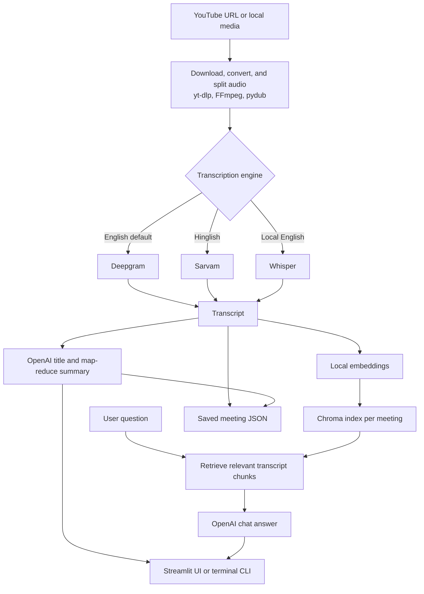

# AI Video Assistant

AI Video Assistant turns a YouTube video or local audio/video file into a transcript, a summary, and a chat interface for asking questions about the recording.

## How it works



The transcript is the shared source for both the summary and chat. OpenAI creates the title and summary, while Chroma stores transcript embeddings locally so chat can retrieve passages relevant to each question.

1. `yt-dlp` downloads YouTube audio; `pydub` and FFmpeg convert and split audio into chunks.
2. A transcription engine turns the audio into text: Deepgram is the English default, Sarvam handles Hinglish, and Whisper runs locally for English.
3. **OpenAI** generates a title and a concise summary. Long transcripts are summarized in sections and then combined.
4. Transcript chunks are embedded locally and stored in Chroma. The chat retrieves relevant chunks and uses OpenAI to answer questions about the video. Greetings and general questions receive conversational replies too.

## Components

| File | Purpose |
|---|---|
| `app.py` | Streamlit interface for processing videos, viewing results, and chatting. |
| `main.py` | Shared pipeline, terminal interface, and saving/loading meetings. |
| `check_setup.py` | Checks configuration, binaries, imports, and API connectivity. |
| `core/transcriber.py` | Routes audio to Deepgram, Sarvam, or Whisper. |
| `core/summarizer.py` | Uses OpenAI for title generation and map-reduce summaries. |
| `core/vector_store.py` | Splits transcripts and stores their embeddings in Chroma, per meeting. |
| `core/rag_engine.py` | Retrieves transcript passages and builds the OpenAI chat chain. |
| `utils/audio_processor.py` | Downloads, converts, and chunks audio. |

## Requirements

- Python 3.10 or later.
- FFmpeg installed and available on `PATH` (`winget install Gyan.FFmpeg` on Windows).
- A Deepgram API key for the default transcription engine and an OpenAI API key for titles, summaries, and chat. Sarvam is optional for Hinglish.

## Setup

```powershell
python -m venv .venv
.\.venv\Scripts\Activate.ps1
python -m pip install -r requirements.txt
Copy-Item .env.example .env
```

Open `.env` and add your keys:

```env
DEEPGRAM_API_KEY=your_deepgram_key
OPENAI_API_KEY=your_openai_key
OPENAI_MODEL=gpt-4o-mini
SARVAM_API_KEY=your_sarvam_key
```

`SARVAM_API_KEY` is only needed for Hinglish transcription. Keep `.env` private and never commit it. Run the preflight check before processing a long recording:

```powershell
python check_setup.py
```

## Run

Start the web app:

```powershell
streamlit run app.py
```

Open the local URL printed in the terminal. Choose a YouTube URL or upload a file, select a transcription engine, and process the video. The result view contains the summary, transcript, and chat.

For the terminal interface:

```powershell
python main.py
```

It lets you reopen a saved meeting by number or enter a new YouTube URL or local file path.

## Saved data and chat history

- Meeting details, transcript, and summary are saved as JSON files in `outputs/`.
- Chroma transcript embeddings are stored in `vector_db/`; downloaded and processed audio is stored in `downloads/`.
- Chat messages are temporary Streamlit session state. They are not saved with meetings and reset when another meeting is loaded or processed, the meeting is cleared, or the app session ends.

These folders and `.env` are excluded from Git by `.gitignore`.

## YouTube cookies

Public videos usually need no browser cookies. If YouTube requests sign-in, first update `yt-dlp`. If needed, set `YTDLP_BROWSER=firefox` (or another supported browser) in `.env`, or export cookies in Netscape format and set `YTDLP_COOKIES=downloads/youtube-cookies.txt`. Cookie-file configuration takes precedence. Keep exports private, use them only when necessary, and delete them when finished. On Windows, Chrome may prevent `yt-dlp` from reading its cookie database while Chrome is running.

## Privacy

Deepgram, Sarvam, and OpenAI are cloud services; audio or transcript content sent to them leaves your machine. Whisper transcription runs locally, but title generation, summaries, and chat still use OpenAI.

## License

MIT. See `LICENSE`.
